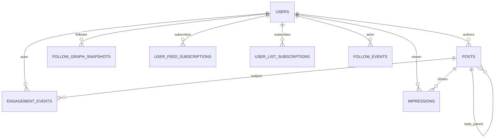

# BridgEU offline dataset — schema specification for the platform

**Date:** 2026-09-15 · **From:** DS team · **To:** Eurosky platform engineering
**Purpose:** Field-level table specs the platform can build to. Phase 1 is the
development set; Phase 2 is nice-to-have (please provision the pipes now even if
data lands later). Companion: `2026-09-15-data-request.md` (narrative),
`2026-09-15-data-sources.md` (what is/insn't reachable without you).

## Conventions

- **Identifiers.** `user_id`/`*_id` on people = ATProto **DID** strings
  (`did:plc:…`); posts = **`at://` URIs**; `cid` = content hash. Pseudonymized
  DIDs are fine **iff** the mapping is stable and identical across *every* table
  so they join.
- **Type vocabulary** (Parquet-first; JSONL equivalents in parens): `string`,
  `int32`, `int64`, `float32`, `float64`, `bool`, `timestamp` (UTC, µs
  precision; ISO-8601 in JSONL), `date` (`YYYY-MM-DD`), `array<T>`,
  `enum<…>` (stored as `string`), `json` (nested struct / JSON string).
- **Keys.** PK = primary key, FK = foreign key. Referential integrity should
  hold within a delivery (every `subject_post_id` resolves to `posts`).
- **Window.** One fixed month `[t0, t0+30d)`; the follow graph sampled **weekly**
  at `t0, t0+7, t0+14, t0+21 (, t0+28)`.
- **Cohort (account universe).** Define once so tables join: the set of DIDs that
  **authored or engaged** in-window, plus (for the graph) their follow
  neighborhood. `posts`, `engagement_events`, `users`, and the graph all refer to
  this cohort. Please state the exact rule used.
- **Format.** Parquet preferred (types enforced), partitioned by day for events
  and by `snapshot_date` for the graph; JSONL acceptable.
- **Model-derived fields** (topics, harmful labels) carry a `*_source`/model
  tag; if the platform doesn't produce them, deliver `null` and DS will fill.
- **PII/GDPR.** User-level engagement, graph, and impressions are personal data;
  minimization, purpose limitation (offline research), access control, and an
  agreed retention policy apply.

## Entity relationships

---

# Phase 1 — development dataset

## 1. `posts` — content + metadata (one row per post, **including replies**)

Grain: one post. Holds all content once; the `(actor, post content, timestamp)`
triplet is `engagement_events ⋈ posts ON subject_post_id`.

| field | type | null | key | description |
|---|---|---|---|---|
| `post_id` | string | no | PK | post `at://` URI |
| `cid` | string | yes | | content hash |
| `author_id` | string (DID) | no | FK→users | who wrote it |
| `created_at` | timestamp | no | | post creation time (UTC) |
| `text` | string | yes | | post text |
| `langs` | array<string> | yes | | BCP-47 codes, e.g. `["en","de"]` |
| `is_reply` | bool | no | | true if a reply |
| `reply_parent_id` | string | yes | FK→posts | immediate parent (replies only) |
| `reply_root_id` | string | yes | FK→posts | thread root (replies only) |
| `embed_urls` | array<string> | yes | | external link URLs |
| `contains_images` | bool | yes | | |
| `contains_video` | bool | yes | | |
| `topic_broad` | enum<string> | yes | | coarse topic, e.g. `politics` (see §provenance) |
| `topic_narrow` | enum<string> | yes | | fine topic, e.g. `immigration` |
| `topic_confidence` | float32 | yes | | [0,1] classifier confidence |
| `harmful_labels` | array<string> | yes | | moderation labels, e.g. `["hate","harassment"]`; `[]`=clean |
| `toxicity_score` | float32 | yes | | [0,1] model score |
| `harmful_source` | string | yes | | model/labeler + version |
| `like_count` | int32 | yes | | as-of `counts_at` |
| `repost_count` | int32 | yes | | as-of `counts_at` |
| `reply_count` | int32 | yes | | as-of `counts_at` |
| `quote_count` | int32 | yes | | as-of `counts_at` |
| `counts_at` | timestamp | yes | | when counts were read |
| `deleted` | bool | yes | | true if known deleted by `counts_at` |

Note: because replies are rows here, **reply toxicity for the HaR model comes
free** via `harmful_labels`/`toxicity_score` on reply posts.

## 2. `engagement_events` — like / repost / reply events (the triplets)

Grain: one engagement event. All in-window events over the cohort.

| field | type | null | key | description |
|---|---|---|---|---|
| `event_id` | string | no | PK | record `at://` URI (like/repost/reply record) |
| `event_type` | enum<like,repost,reply> | no | | interaction kind |
| `actor_id` | string (DID) | no | FK→users | who engaged |
| `subject_post_id` | string | no | FK→posts | post engaged with (for reply = parent) |
| `subject_author_id` | string (DID) | yes | FK→users | author of subject post (denormalized) |
| `created_at` | timestamp | no | | when the engagement happened (UTC) |
| `reply_post_id` | string | yes | FK→posts | for `reply`, the reply's own post |
| `time_us` | int64 | yes | | firehose µs, for exact ordering |

Uniqueness: `(actor_id, subject_post_id, event_type)` should be unique for
like/repost (one standing like per user-post). **Deletions/un-likes:** state
whether removed engagements are excluded (survivorship) or included with a
tombstone — matters for the exposure/null model.

## 3. `follow_graph_snapshots` — weekly directed follow edges

Grain: one directed edge present in one weekly snapshot.

| field | type | null | key | description |
|---|---|---|---|---|
| `snapshot_date` | date | no | PK | week label (`t0`, `t0+7`, …) |
| `follower_id` | string (DID) | no | PK, FK→users | source (the follower) |
| `followed_id` | string (DID) | no | PK, FK→users | target (the followed) |

Composite PK `(snapshot_date, follower_id, followed_id)`; deliver partitioned by
`snapshot_date` (4–5 partitions). Per-edge timestamps are **Phase 2** (`follow_events`).

## 4. `users` — user metadata

Grain: one cohort user (as of `snapshot_at`).

| field | type | null | key | description |
|---|---|---|---|---|
| `user_id` | string (DID) | no | PK | account DID |
| `handle` | string | yes | | current handle |
| `created_at` | timestamp | no | | account creation date |
| `followers_count` | int32 | yes | | number of followers (as-of) |
| `follows_count` | int32 | yes | | number followed (as-of) |
| `posts_count` | int32 | yes | | lifetime posts (as-of) |
| `snapshot_at` | timestamp | no | | when metadata read |

`followers_count` should be consistent with the nearest `follow_graph_snapshots`.
Feed/blocklist subscriptions are the two bridge tables below (many-to-many;
deliver as tables, or inline as `array<string>` on `users` if simpler).

## 5. `user_feed_subscriptions` — feeds a user subscribes to

Grain: one (user, feed) subscription, as-of snapshot.

| field | type | null | key | description |
|---|---|---|---|---|
| `user_id` | string (DID) | no | PK, FK→users | subscriber |
| `feed_uri` | string | no | PK | feed generator `at://` URI |
| `snapshot_at` | timestamp | no | | when read |
| `subscribed_at` | timestamp | yes | | when subscribed (Phase 2; null ok now) |

## 6. `user_list_subscriptions` — blocklists / mutelists a user subscribes to

Grain: one (user, list) subscription, as-of snapshot. (Moderation lists the user
*applies*, distinct from individual blocks the user *creates* — those are a
separate, more sensitive Phase-2 negative-signal set.)

| field | type | null | key | description |
|---|---|---|---|---|
| `user_id` | string (DID) | no | PK, FK→users | subscriber |
| `list_uri` | string | no | PK | graph list `at://` URI |
| `list_type` | enum<blocklist,mutelist> | no | | how it's applied |
| `snapshot_at` | timestamp | no | | when read |
| `subscribed_at` | timestamp | yes | | when subscribed (Phase 2; null ok now) |

---

# Phase 2 — nice-to-have (please provision infra now)

## 7. `follow_events` — timestamped follow/unfollow history

Grain: one follow action. Supersedes the weekly snapshots (any instant
reconstructable); weekly snapshots are the Phase-1 fallback.

| field | type | null | key | description |
|---|---|---|---|---|
| `event_id` | string | no | PK | follow record `at://` URI |
| `follower_id` | string (DID) | no | FK→users | source |
| `followed_id` | string (DID) | no | FK→users | target |
| `action` | enum<follow,unfollow> | no | | create or remove |
| `created_at` | timestamp | no | | follow createdAt; unfollow = deletion time (may be approximate) |
| `time_us` | int64 | yes | | firehose µs |

## 8. `impressions` — exposure logs (after users subscribed to a feed)

Grain: one impression (a post shown to a viewer). Only for users subscribed to
the DS/experimental feed(s). **Platform-only — no public source exists.**
Sampling or the daily aggregate (§8a) is acceptable if full logs are too heavy.

| field | type | null | key | description |
|---|---|---|---|---|
| `impression_id` | string | no | PK | unique id (or `(viewer_id,post_id,shown_at)`) |
| `viewer_id` | string (DID) | no | FK→users | who saw it |
| `post_id` | string | no | FK→posts | what was shown |
| `feed_uri` | string | no | | which feed/surface |
| `shown_at` | timestamp | no | | when shown (UTC) |
| `position` | int32 | yes | | rank in the shown list |
| `context` | string | yes | | client/surface context (`feedContext` token) |
| `dwell_ms` | int32 | yes | | engagement time if available |

### 8a. `impressions_daily` — aggregate fallback (if full logs infeasible)

| field | type | null | key | description |
|---|---|---|---|---|
| `date` | date | no | PK | day |
| `post_id` | string | no | PK, FK→posts | post |
| `feed_uri` | string | no | PK | surface |
| `impression_count` | int64 | no | | times shown that day |
| `unique_viewers` | int64 | yes | | distinct viewers |

---

## Provenance of model-derived fields (please confirm)

- **`topic_broad` / `topic_narrow`.** If the platform runs a topic classifier,
  supply its labels + `topic_confidence` and share the **controlled vocabulary**
  (broad set, e.g. politics/sports/tech/health/entertainment/news/science…; and
  the narrow taxonomy). If not, deliver null — DS derives topics (own topic
  model / greenearth) and defines the vocabulary.
- **`harmful_labels` / `toxicity_score`.** Prefer the platform's existing
  moderation label taxonomy (share the value set) plus, if available, a
  continuous toxicity score and the model/version in `harmful_source`. If not
  produced, DS scores post/reply text (Perspective/toxic-BERT) — but native
  labels are preferred where they exist.

## Open questions for the platform

1. Exact **cohort** definition (whose events/posts/graph) so tables join.
2. **Deletion handling** in `engagement_events`/`posts` (survivorship vs
   tombstones).
3. **Taxonomies**: topic vocabulary and moderation-label value set.
4. Actual in-window **row counts** (likes, reposts, replies, posts, edges, users)
   to size storage.
5. **Impression** scope: full logs vs sample vs `impressions_daily`, and which
   feed(s).

## First delivery to unblock DS

A small **1-day sample** of `posts` + `engagement_events` (schemas above) to
validate the contract, then the full 30-day `posts` + `engagement_events` and
the 4–5 `follow_graph_snapshots` + `users`. Phase 2 pipes (`follow_events`,
`impressions`) provisioned in parallel; data can follow.
