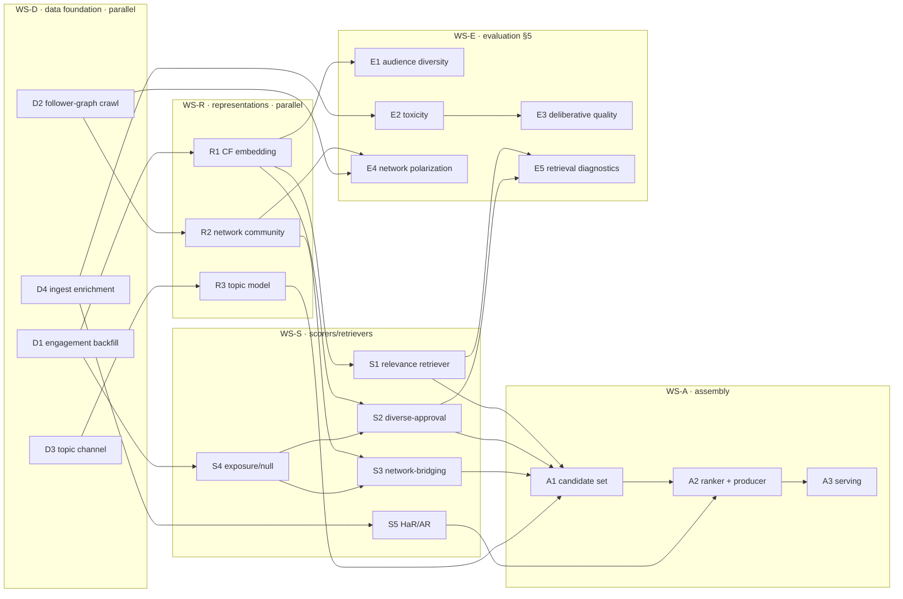

# BridgEU implementation plans — modular workstreams, experiment path-dependencies, and evaluation

**Date:** 2026-09-15
**Scope:** Turn `overview.md` into buildable, parallelizable workstreams for
offline development; enumerate the sub-plans that branch on experimental
outcomes (§4); and give a standalone evaluation plan (§5). Grounded in the
existing repo contracts so modules decouple through *artifacts*, not code.

**Companion docs:** `2026-09-15-data-sources.md` (what data is viable + a time
benchmark) and `2026-09-15-conceptual-evaluation.md` (specification decisions
that gate these plans). Section references (§) point at `overview.md`.

---

## 0. Design principles (why these plans are parallelizable)

The repo already enforces the property that makes fan-out safe: **steps depend
on each other's *outputs*, named by catalog ref, never on each other's code**
(`corpus/probe-200` → a file; features are versioned JSONL artifacts published
to a store). Every plan below is written as one or more of the three seams the
repo already has:

1. **A feature extractor** — one owner module, a pure `compute(...)`, and the
   five declarations (`FEATURE`, `MODEL_VERSION`, `KEYED_BY`, `DEFAULT`,
   `REQUEST_SAFE`); output is a versioned artifact published to the store.
2. **An algo / feed producer** — reads corpus + feature refs, emits a
   `feed_doc`, publishes under its own rkey. (This seam exists but is currently
   *unwired* — no producer — so building one is itself a task.)
3. **An eval metric** — a pure function of `(feed rows, corpus)` (+ optionally
   graph/viewpoint artifacts), added under `evals.metrics`.

**Rule for every new estimator:** it is a **new versioned artifact**, selected
by `MODEL_VERSION`, never an in-place edit — so experimental variants coexist
and consumers pin what they use. This is what lets the path-dependency branches
(§4 below) run concurrently without forking the pipeline.

**Contract discipline (from the conceptual evaluation):** any diverse-approval /
audience-dispersion estimator must declare, as part of its spec, its *null
model*, its *sample-split*, and its *degree-weighting* — these are inputs to
`compute`, versioned in `MODEL_VERSION`, not incidental choices.

## 1. Component inventory → repo seam → dependency

| # | component | seam | consumes | produces (ref) | present? |
|---|---|---|---|---|---|
| D1 | engagement-event backfill (`getLikes`/`getRepostedBy` per corpus post) | ingest CLI | corpus | `raw/events/backfill-<stem>` | no (infra I1 open) |
| D2 | follower-graph crawl (BFS `getFollows`/`getFollowers`) | ingest CLI | seed DIDs (corpus authors+engagers) | `graph/follows-<stem>` (edge list) | no |
| D3 | topic-retrieval channel (Skylight key / authed `searchPosts` / topical feed) | ingest CLI | topic terms | `corpus/topic-<name>` | no (auth gap) |
| D4 | ingest enrichment: carry `langs`, mention facets, `is_reply`; optional realized-negative | edit `jetstream.parse_event` / `corpus` | firehose | richer event/corpus rows | partial |
| R1 | behavioral CF embedding (user+post vectors, shared space) | feature extractor | D1 events / like slice | `features/cf_users`, `features/cf_posts` | R1a spectral exists (unrun on real data) |
| R2 | network community + distance (follow-graph embedding / Louvain) | feature extractor | D2 graph | `features/net_community`, `features/net_embed` | no |
| R3 | topic model (content embedding + clustering) | feature extractor | D3/content | `features/post_topic` | no |
| S1 | relevance retriever (ANN top-k over post vectors) | algo/retriever | R1 | relevance Top-K per user | no (only `cf` rerank) |
| S2 | diverse-approval (behavioral bridging) scorer | feature extractor | R1 + D1 (+S4 null) | `features/bridge_behavioral` | no |
| S3 | network-bridging scorer (cross-community approval share) | feature extractor | R2 + D1 (+S4 null) | `features/bridge_network` | no |
| S4 | exposure / null model ("who could have seen it") | feature extractor | D1 + D2 | `features/exposure` | no |
| S5 | HaR/AR model (predict harmful-response risk from text) | feature extractor | D4 (reply labels) + E2 labeler | `features/har`, `features/ar` | heuristic stub only |
| A1 | candidate-set builder (union → dedup → topic-diversify) | algo | S1 + S2/S3 + R3 | candidate set | no (popularity-only today) |
| A2 | multi-objective ranker (weighted → learned) + wired feed producer | algo/feed producer | A1 + S2/S3 + S5 + recency | `scores/<algo>`, published feed | `rank.py` exists but unwired |
| A3 | serving integration (per-variant rkey; per-viewer rerank if needed) | serve | published feeds / store | feed skeleton | endpoint exists |
| E1–E5 | evaluation metric set (§5) | eval metrics | feeds + R1/R2/D2 | metric reports | author-diversity only |

## 2. Dependency graph

## 3. Workstream plans

Each plan: **goal · components · method · inputs→output · deps · experiments
(§4) · validation · decision gate.** WS-D and WS-R have no cross-dependencies
and can be staffed fully in parallel from day one.

### WS-D — data foundation (no model dependencies; start immediately)

**D1 · Engagement-event backfill.** *Goal:* real `(user, post)` like/repost
edges at corpus scale so CF and the bridging scorers run on real data. *Method:*
new `backfill-engagement` CLI paginating `getLikes` + `getRepostedBy` over every
corpus post (benchmark: ≈ 111 like-edges/s single-thread; concurrency lifts
this), normalized into the existing raw-event schema so `likes_spectral` and the
scorers consume it unchanged. *Output:* `raw/events/backfill-<stem>`. *Deps:*
corpus only. *Validation:* edge counts reconcile with corpus `like_count`;
deterministic re-run. *Gate:* none — foundational.

**D2 · Follower-graph crawl.** *Goal:* the social graph for network distance,
community labels, and §5 network metrics. *Method:* `crawl-follows` CLI, BFS
from corpus authors + engagers via `getFollows`/`getFollowers` (≈ 100 accts/s/
page; hubs like 35 M-follower accounts sampled or capped, not fully expanded),
written as an edge-list artifact + node set. Parameterize hop count, per-node
fan-out cap, and hub threshold. *Output:* `graph/follows-<stem>`. *Deps:* seed
DIDs. *Validation:* degree distribution sane; giant-component fraction reported.
*Gate:* none.

**D3 · Topic-retrieval channel.** *Goal:* fetch posts by topic (the §2.3 topic
step and the topic model both need it). *Method:* resolve the auth question
first (request a greenearth Skylight key **and/or** stand up an authenticated
AppView session for `searchPosts`; fall back to curated topical feed generators;
last resort keyword-filter a firehose window — expensive, §data-sources 5.3).
Wrap the chosen channel behind one `fetch-topic` CLI so downstream code is
channel-agnostic. *Output:* `corpus/topic-<name>`. *Deps:* an API key or session
(external). *Gate:* channel choice (G-Topic) — settle before R3/A1.

**D4 · Ingest enrichment.** *Goal:* don't lose fields the plan needs. *Method:*
extend `parse_event`/corpus records to carry `langs`, mention facets
(`richtext.facet#mention`), and an `is_reply` flag; scope a separate stream for
realized-negative signals (deletes/un-likes/blocks are currently dropped at the
door). *Output:* richer rows, same files. *Deps:* none. *Gate:* whether
realized-negative is in scope (see conceptual-eval §3.7).

### WS-R — representations (parallel; each an independent feature artifact)

**R1 · Behavioral CF embedding.** *Goal:* shared user/post latent space
(relevance + behavioral distance). *Components/branches (path-dependent, §5
below):* R1a spectral CF (exists — validate), R1b biased matrix factorization
matching Fig.1 `r̂=μ+b_u+b_i+p_uᵀq_i` (ALS/`implicit`), R1c two-tower+ANN
(scale/cold-start). *Method:* fit on D1 (or a live like-slice), emit
`cf_users`/`cf_posts` under a per-variant `MODEL_VERSION`; **hold out an edge
fold** for the scorers' sample-split (conceptual-eval §3.1). *Deps:* D1.
*Validation:* planted-community recovery on a synthetic graph (ground truth);
held-out like-prediction; cold-start coverage (% users/posts embedded). *Gate:*
G1 (representation choice).

**R2 · Network community + distance.** *Goal:* community labels and a
follower-graph distance. *Method:* on D2, run community detection (Leiden/
Louvain) and/or a spectral/`node2vec` embedding; emit `net_community` (label)
and `net_embed` (vector) artifacts. *Deps:* D2. *Validation:* modularity;
stability across crawl subsamples; agreement vs behavioral clusters (an
empirical, not assumed, correspondence). *Gate:* G2 (distance modality).

**R3 · Topic model.** *Goal:* post topic for diversification + optional
topic-conditioning. *Method:* content embeddings (reuse greenearth
`minilm_l12` if keyed, else local MiniLM) → clustering / BERTopic; emit
`post_topic`. *Deps:* D3/content. *Validation:* cluster coherence; human spot
check on a sample. *Gate:* G3 (topic-conditioning on/off).

### WS-S — scorers & retrievers

**S1 · Relevance retriever.** *Goal:* per-user top-k by latent proximity —
turning the current request-time `cf` *rerank* into actual *retrieval*.
*Method:* build an ANN index over `cf_posts`; query with the user vector; return
Top-K. *Deps:* R1. *Validation:* recall vs brute-force dot product; latency.
*Gate:* none (contract-insulated from R1 variant).

**S2 · Diverse-approval (behavioral bridging) scorer — critical path.** *Goal:*
the §2.2.1 estimator. *Method (spec is the deliverable, per conceptual-eval
§3.1):* for each post, take its positive engagers (D1), compute audience
dispersion in the **held-out** R1 space, **degree-weight** engagers (shrinkage
for the ~single-like majority), and express the score as a **residual/z-score
against a reach-matched null** (S4). Emit `bridge_behavioral`. *Deps:* R1
(held-out fold) + D1 + S4. *Validation:* on a synthetic graph with planted
cross-community "bridge" posts, the estimator must rank them above
popularity-matched non-bridges; must *not* correlate with raw popularity after
the null correction. *Gate:* G0 (retrieval necessity) is measured here.

**S3 · Network-bridging scorer.** *Goal:* cross-community approval from the
follower graph. *Method:* per post, share/entropy of engager **communities**
(R2), null-corrected (S4), positive-engagement only. Emit `bridge_network`.
*Deps:* R2 + D1 + S4. *Validation:* analogous synthetic planted-community test;
report standalone lift vs S2 and their overlap. *Gate:* G2.

**S4 · Exposure / null model.** *Goal:* the "expected diversity at comparable
reach" denominator. *Method:* estimate a per-post exposure/reach proxy from D1
(engager count, author follower reach from D2) and generate the matched-null
audience-dispersion distribution (permutation over reach-matched engager sets).
Emit `exposure`. *Deps:* D1 (+D2). *Validation:* null is flat vs popularity by
construction; sensitivity to the matching variable. *Gate:* feeds S2/S3.

**S5 · HaR / AR model.** *Goal:* predict, from post text, harmful-response risk
(§2.4) — replacing the heuristic stubs. *Method:* label training data using the
best §5 toxicity model (E2) on *realized* replies (D4), fine-tune a multilingual
text model to predict reply-toxicity rate (HaR) and affective intensity (AR);
emit `har`/`ar`. *Deps:* D4 + E2. *Validation:* held-out AUC vs the realized
label; calibration; **language-stratified** performance. *Gate:* independent
(content-only branch).

### WS-A — assembly

**A1 · Candidate-set builder.** *Goal:* §2.3. *Method:* union(S1 relevance
Top-K, S2/S3 bridging Top-K) → dedup → topic-diversify over R3 (cap per topic) →
optional permissive relevance floor on bridging candidates. Decide global-
bridging-then-filter vs per-user (conceptual-eval §3.4). *Deps:* S1, S2/S3, R3.
*Validation:* candidate distribution under replay; topic balance. *Gate:* G3.

**A2 · Multi-objective ranker + wired feed producer.** *Goal:* §2.4, and close
the repo's biggest gap (no wired feed producer, §7A of the repo learnings).
*Method:* build the missing producer package (reads corpus + feature refs,
checks `model_version`, emits `feed_doc`, `publish-serving`); score =
interpretable weighted sum of relevance + bridging + recency − HaR first, then a
learned ranker once trade-off curves justify it. Reuse `baseline/rank.py`
patterns. *Deps:* A1, S2/S3, S5. *Validation:* the §5 metric set on replayed
feeds; weight-sweep trade-off curves. *Gate:* G4 (weighted vs learned).

**A3 · Serving integration.** *Goal:* publish each variant under its own rkey;
add a per-viewer rerank branch only if bridging is genuinely per-user. *Method:*
reuse `bridgeu-serve`; every variant is a publish, not a deploy. *Deps:* A2.
*Validation:* skeleton parity; cursor pinning. *Gate:* none.

## 4. Experiment path-dependency sub-plans (the branch points of §4)

These are the places where a *downstream* plan changes based on an *experiment's
result*. Each gate is a small, pre-registered comparison with an explicit
selection criterion decided **before** looking at the estimate (per the project's
analysis rules). Because every variant is a separate versioned artifact, the
branches run **concurrently**; the gate only decides which artifact the next
stage pins.

| gate | question | experiment (selection criterion fixed in advance) | branches & downstream effect |
|---|---|---|---|
| **G0** meta | Is a dedicated bridging *retriever* needed at all (§3)? | measure **overlap(relevance, bridging Top-K)** and **recall of known bridge posts** with vs without S2/S3 | high overlap → collapse to rerank-only (drop A1's bridging arm); low overlap → keep the pathway. Decided from S2/E5 output. |
| **G1** representation | spectral (R1a) vs biased-MF (R1b) vs two-tower (R1c)? | held-out like-prediction + cold-start coverage + planted-community recovery | S1/S2/E1 pin one `cf_*` `MODEL_VERSION`; contract-insulated, so only the *artifact selected* changes, not the consumers. Cold-start coverage decides if a fallback retriever is required. |
| **G2** distance modality | behavioral (S2) vs network (S3) vs combined? | standalone bridging-recall lift of each + their overlap + agreement of R1 clusters with R2 communities | separate two retrievers, or fuse into one bridging score. Changes A1's inputs and the number of Top-K lists to union. |
| **G3** topic conditioning | condition dispersion/representation on topic (R3) or not? | does cross-community approval track the *relevant* dimension vs generic diversity (compare topic-conditioned vs unconditioned S2 against E1 with a topic-aware null) | if yes, R3 becomes an input to S2/S3 (topic-conditioned scores), not only to A1's diversification. |
| **G4** ranker form | weighted (interpretable) vs learned? | offline metric trade-off curves (relevance vs bridging vs toxicity@k) + stability | weighted stays as the transparent baseline/guardrail; learned promoted only if it dominates on the pre-set frontier. |
| **G-Topic** | Skylight key vs authed `searchPosts` vs topical feed vs firehose filter? | coverage, freshness, latency, cost (data-sources §5–6) | picks D3's channel; unblocks R3 + A1. |

**Two independent critical paths** emerge, which is what makes the program
parallelizable end to end:

- **Bridging path:** D1 → R1(+held-out) → S4 → **S2** → (G0/G2) → A1 → A2. The
  estimator specification (S2) is the long pole; validate on synthetic first.
- **Quality path:** D4 → E2 → **S5** → A2, entirely content-side, sharing
  nothing with the bridging path until the ranker — so it proceeds in parallel.

Network (D2 → R2 → S3) and topic (D3 → R3) are two further independent tracks
that join at the gates. Relevance (R1 → S1) is shared infrastructure both the
retrieval thesis (G0) and the ranker need.

## 5. Evaluation plan (`overview.md` §5)

A standalone workstream (WS-E): a set of pure metrics over `(feed, corpus)`
plus the graph/viewpoint artifacts, added under `evals.metrics`, reported per
feed version through the existing `evaluate` CLI + MLflow. Offline results are
**observational** (measured on replayed/historical interactions of feeds that
were actually shown) and are reported as associational; causal claims wait for
the online phase (infra R4).

**E1 · Audience diversity & bridging.** *Metrics:* engager-viewpoint dispersion
per post (variance / unbiased Gini–Simpson), average pairwise engager distance,
cross-community engagement share, and out-of-author-community share — each
computed **separately for positive engagement and for replies** (to distinguish
diverse approval from diverse attention/conflict), against a **corpus null** and
with **degree weighting**, using a viewpoint fold **disjoint from any the
retriever trained on** (conceptual-eval §3.1/§5). *Inputs:* R1/R2, D1.
*Headline:* fraction of feed achieving *both* high audience diversity *and* high
positive-response rate.

**E2 · Civility & toxicity.** *Metrics:* prevalence/severity of toxic
interactions, and specifically **cross-community** interaction toxicity.
*Method:* benchmark toxic-BERT vs Perspective API vs OpenAI omni-moderation on a
labeled sample, **stratified by language** (Eurosky is multilingual — Perspective
is broadly multilingual, `toxic-BERT` English-centric), select the best per
language, then score realized replies. *Inputs:* D4 replies. *Feeds E3 and S5.*

**E3 · Deliberative quality.** *Metrics:* whether replies give reasons/evidence
and acknowledge competing considerations (comment- and thread-level), and
conversation coherence (do replies respond to what precedes). *Method:*
NLP-scaled classifiers validated against a **human-annotated subset** (report
inter-annotator agreement); cite Fu & Ollagnier 2026, Oswald 2022, Seckin et al.
2026. *Inputs:* D4 threads.

**E4 · Network-level polarization.** *Metrics:* assortativity, modularity, and
cross-community edge share of mention/reply networks; **quality-weighted**
variants that down-weight toxic edges (E2) to separate constructive from hostile
cross-community contact. *Method:* build the reply/mention network (data-sources
§5.2: `getPostThread` + facets, or firehose reply edges) with communities from
D2/R2. *Inputs:* D2/R2, D4, E2.

**E5 · Retrieval diagnostics (serves the gates).** *Metrics:* overlap(relevance,
bridging) Top-K (G0), recall of known bridge posts, candidate-set topic balance,
and how alternative operationalizations shift the candidate distribution under
replay/simulation. *Inputs:* S1, S2/S3, A1.

**Validation harness shared by all E:** a **synthetic planted-community corpus**
with known bridge posts and known cross-/within-community reply toxicity, so
each metric is checked where ground truth exists *before* it is trusted on real
data — the same synthetic fixture that validates S2/S3 (R1 §5 in the research
agenda: "validate via planted-community recovery").

## 6. Parallelization & sequencing summary

| phase | run concurrently | gate to exit | maps to |
|---|---|---|---|
| **P-A foundation** | D1, D2, D4, and D3-channel decision | data artifacts land; G-Topic chosen | infra I1; research R2 |
| **P-B representations** | R1 (a/b/c variants), R2, R3 — all independent artifacts | G1 (repr), G2 prep, G3 prep | research R1/R2 |
| **P-C scorers** | S1, S4, S2, S3, S5 — S2/S3 gated by S4; S5 fully independent | G0 (retrieval necessity), G2 | research R2 |
| **P-D assembly** | A1 → A2 → A3 | G3, G4 | research R2/R3; infra I2 |
| **WS-E evaluation** | runs alongside from P-B onward on synthetic, then real | — | research R1–R4 |

**Longest pole:** the S2 diverse-approval estimator specification + synthetic
validation. Everything else (relevance, network, topic, HaR, eval harness) is
independent enough to staff in parallel and to have ready when S2's spec lands.

**First three concrete tickets (unblock the most):** D1 backfill (real CF data),
D2 crawl (network + eval), and the S2 estimator spec validated on a synthetic
planted-community graph — plus the G-Topic auth decision, which is an email, not
a build.

## 7. Notes on reuse and non-duplication

- The existing serving store, catalog, artifact schema, MLflow tracking, feed
  producer contract, and `cf` rerank are reused unchanged; new work is new
  *artifacts* and *modules*, not pipeline rewrites.
- `baseline/rank.py` and `scorers.py` are ready patterns for A2's producer and
  S5's interface (their HaR/AR are stubs to replace, not delete).
- The repo's two prior drafts in `Bao/` (a bridging-ranker plan and a for-you
  design) overlap parts of WS-S/WS-A; they were **not** treated as source of
  truth per the task brief, but converge on the same diverse-approval + null-
  model + audience-diversity direction, which is corroborating.
